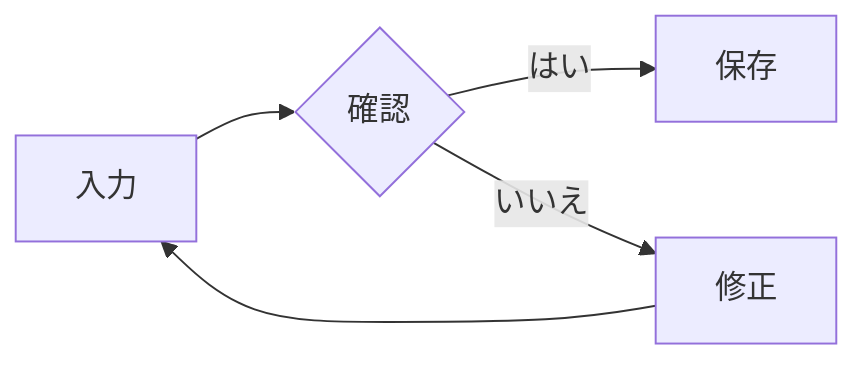
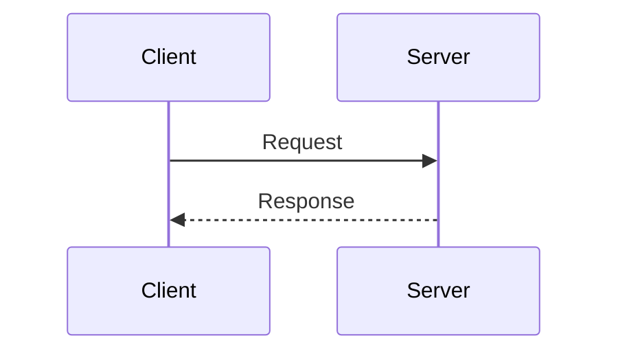
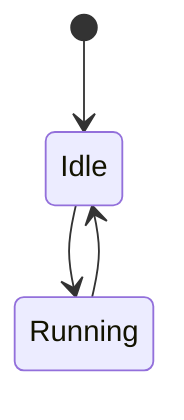

# Markdown graphics

## Inline mathematics

A fraction $\frac{a}{b}$ and a radical \(\sqrt{x^2 + y^2}\) stay on the text baseline.
GitHub's $`E=mc^2`$ notation works too. Prices remain prose: $5 and $10.

## Display mathematics

$$
\int_0^\infty e^{-x^2}\,dx = \frac{\sqrt{\pi}}{2}
$$

\[
\begin{aligned}
f(x) &= \begin{cases} x^2 & x \ge 0 \\ -x & x < 0 \end{cases} \\
A &= \begin{pmatrix} 1 & 2 \\ 3 & 4 \end{pmatrix}
\end{aligned}
\]

```latex
\begin{align}
a^2+b^2 &= c^2 \tag{A} \\
\ce{2H2 + O2} &\ce{-> 2H2O} \notag
\end{align}
```

```math
\pu{1.5e-3 mol//L}
```

## Mermaid







## Box drawings become graphics

┌─────────┐     ┌─────────┐
│  入力   │────>│  出力   │
└─────────┘     └─────────┘

```text
project/
├── src/
│   ├── main.rs
│   └── markdown.rs
└── Cargo.toml
```

## Ordinary Markdown

- Normal **formatting** and `code` still work.
- Formulas in lists: $x^2+y^2$.

> Formulas in quotes: \(a+b\).

| Value | Formula |
| :--- | ---: |
| Area | $\pi r^2$ |

```rust
// A source-code fence is never converted into a diagram.
// ┌────┐
// │code│
// └────┘
fn main() {}
```
